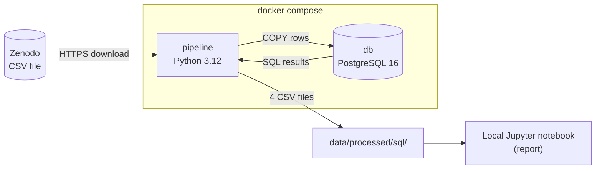

# Erasmus+ Mobility Explorer

**Which countries send and receive the most Erasmus+ mobility participants, how have flows changed over time, and how efficiently can a PostgreSQL pipeline process 588,109 records?**

Individual project for *Computational Infrastructures for Data Science* (CIDS), LUISS.

## Team

**Individual project** by Alua Ilyassova, completed as part of the CIDS course (non-attending student). Expected workload: approximately 30 hours.

## How to run

Requirements: Docker Desktop (or Docker Engine with Compose) and Git. Nothing else needs to be installed.

```bash
git clone https://github.com/alua-emes/erasmus-mobility-explorer.git
cd erasmus-mobility-explorer
cp .env.example .env          # Windows PowerShell: Copy-Item .env.example .env
docker compose up --build
```

The pipeline checks the local dataset and downloads it from Zenodo if missing or invalid (about 18 MB, MD5-verified), creates the table, loads the data, validates it, runs the SQL analysis and writes the results to `data/processed/sql/`. Success is indicated by `PIPELINE COMPLETED SUCCESSFULLY`. The `pipeline` container then exits with code 0 while PostgreSQL keeps running.

To stop: `docker compose down` (the database volume is kept). To reset the PostgreSQL volume: `docker compose down -v` (destructive: deletes the stored database, not the host CSV files).

## Data

| Attribute | Description |
|---|---|
| Dataset | Erasmus+ student mobility flows between NUTS regions, 2014–2023 |
| File | `Erasmus_2014-2023_aggregate_NUTS.csv` (semicolon-separated, 588,109 rows, 5 used columns) |
| Source | [Zenodo, version 1.1](https://doi.org/10.5281/zenodo.16737523), derived from the European Commission's Erasmus+ raw data |
| Licence | CC BY 4.0 |
| Privacy | Aggregated regional flows only, no personal data |
| Integrity check | MD5 `048259d0c7fad5e792e13d0642aee0d8`; existing local file verified on 19 November 2026 |

More details: `docs/data_sources.md`.

## Design decisions (the six questions)

1. **Question.** Which countries send and receive the most Erasmus+ mobility participants, how did flows change over time, and how does pipeline resource usage change with data size?
2. **Data.** The Zenodo file above, downloaded by script, no login needed.
3. **Database: PostgreSQL (SQL), and why.** The dataset has a consistent tabular structure and requires filtering, grouping, aggregation and integrity validation. PostgreSQL supports these operations efficiently through SQL.
The database enforces data integrity through a primary key, NOT NULL constraints, valid year ranges, positive mobility counts and a unique constraint on the origin–destination–year combination at the regional level.
Four stored generated columns derive country codes and geographical indicators directly from the original regional codes. This reduces repetitive transformations and simplifies analytical queries.
4. **Processing.** In SQL: annual international mobility, incoming and outgoing mobility per country (net balance), a normalised balance index, and bilateral country-to-country flows. Domestic flows are excluded from the international analysis.
5. **Output.** Four CSV files in `data/processed/sql/` and a report notebook, `notebooks/02_cids_report.ipynb`, with tables and charts.
6. **Measurements.** Time and disk at 25%, 50% and 100% of the data, three runs each; peak memory in one full-data run; and an index experiment (see below).

## Architecture



- `db`: official `postgres:16` image, data stored in the named volume `postgres_data`, with a healthcheck.
- `pipeline`: built from the `Dockerfile`, starts only when the database is healthy, reaches it by the service name `db`.
- Settings (database name, user, password) come from `.env`, which is never committed. `.env.example` is the template.

## Measurements

Laptop: Intel Core i5-1240P (12 cores, 16 threads), about 16 GB RAM (7.57 GiB available to Docker), Windows with WSL 2, PostgreSQL 16.16. The scalability table reports the original benchmark results (three runs per data size); peak memory was measured separately. Raw results are in `docs/benchmarks/`.

| Measurement | 25% | 50% | 100% |
|---|---:|---:|---:|
| Records | 147,027 | 294,054 | 588,109 |
| CSV size (MiB) | 4.50 | 9.00 | 17.44 |
| Loading time (s) | 0.656 | 1.197 | 2.838 |
| Annual query (ms) | 17.66 | 27.78 | 40.38 |
| Country balance (ms) | 49.45 | 63.13 | 87.44 |
| Relative imbalance (ms) | 50.82 | 61.34 | 88.65 |
| Bilateral query (ms) | 30.73 | 38.78 | 58.76 |
| Benchmark pipeline time (s) | 0.949 | 1.551 | 3.303 |
| Database size on disk (MiB) | 27.33 | 46.43 | 85.58 |
| Table and indexes (MiB) | 19.80 | 38.89 | 78.04 |

**Peak memory** (one full-data run, measured from the container's cgroup):

| Container | Peak memory |
|---|---:|
| Python pipeline | 98.84 MiB |
| PostgreSQL | 289.13 MiB |

**Index experiment** (query filtering by origin country and year, full data):

| Measurement | Without additional index | With additional index |
|---|---:|---:|
| Query execution time (ms, average of 3 runs) | 23.689 | 0.073 |
| Scan type | Sequential Scan | Index Scan |
| Additional index size (MiB) | - | 3.98 |
| Index creation time (s) | - | 0.339 |

The experiment evaluates a selective query filtering
international mobility by origin country (Albania)
and year (2022).

The additional partial composite index is created on
`(origin_country, year)` with the condition
`same_country = FALSE`.

The query execution time decreased by approximately
323 times. Query results were verified to be identical
before and after index creation.

### What the numbers mean

- **Loading is approximately linear over the tested range.** 4× more data took about 4.3× longer to load (0.66 s → 2.84 s). Loading is the slowest step of the pipeline.
- **Query times grew less than proportionally over the tested range.** The annual query became only 2.3× slower with 4× the data; the other three took 1.7–1.9×. Fixed overhead may contribute to this pattern; the experiment does not establish asymptotic complexity.
- **The database is about 5× larger than the CSV** (85.6 MiB vs 17.4 MiB). Storage includes tables, indexes and database overhead. Database size grew by about 3.1× for 4× the records over the tested range.
- **Memory usage was modest in the measured run.** PostgreSQL peaked at 289 MiB, below the 7.57 GiB available to Docker. Larger datasets were not tested.
- **An index helps a lot on selective queries.** The filtered query became about 320× faster for 4 MiB of extra disk. This result applies to the tested selective query, not necessarily to the full-table aggregations.

### Production image and runtime verification

Jupyter and ipykernel are development dependencies installed locally with `uv sync`. The production image is built with `uv sync --locked --no-dev --no-install-project`.

| Metric (19 November 2026) | Result |
|---|---:|
| Docker image disk usage | 405 MB |
| Docker image content size | 97.3 MB |
| Pipeline execution time (existing dataset) | 3.670 s |
| Rows loaded | 588,109 |
| Pipeline exit code | 0 |

These are post-optimization observations, separate from the original benchmark averages. No pre-optimization image size was recorded for comparison. The existing dataset passed checksum validation; a clean download test is required before final submission.

## Main results

- International mobility fell by 47.6% in 2020 (299,401 → 156,916 movements) and by 2023 recovered to 92.8% of its 2019 level (277,771).
- Spain is the leading destination (397,720 movements). France is the largest net sender (−130,007), and the United Kingdom has the largest positive balance (+73,466).
- 639 of the 666 possible country pairs among 37 countries have at least one recorded flow (96% connection density).
- Domestic flows account for about 0.15% of records (884 of 588,109) and 0.10% of the mobility count.

## Database validation

| Metric | Result |
|---|---:|
| Total records | 588,109 |
| Total mobility count | 2,554,116 |
| International records | 587,225 |
| International mobility count | 2,551,560 |
| Years | 10 |
| Directional country connections | 1,217 |

The notebook contains the pandas reference analysis for comparison with SQL results.

## How to reproduce the benchmarks

First, complete the pipeline execution described
in the How to run section.

### Scalability benchmark

```bash
docker compose run --rm pipeline uv run --no-sync python -u src/benchmark.py
```

The benchmark uses three dataset fractions
(25%, 50%, 100%), three repetitions and a fixed
random seed of 42.

Measurements include loading time, PostgreSQL ANALYZE,
validation, analytical queries and storage usage.

Dataset downloading, sample preparation and Docker
startup are excluded from benchmark execution time.

### Index benchmark

```bash
docker compose run --rm pipeline uv run --no-sync python -u src/benchmark_indexes.py
```

The index experiment requires the full dataset.

It compares a selective query before and after creating
an additional partial composite index on
(origin_country, year).

Query execution is measured with EXPLAIN ANALYZE BUFFERS.
The experimental index is removed through transaction
rollback.

Benchmark outputs are saved in `data/processed/sql/`.

Recorded experimental results are available in
`docs/benchmarks/`.

## Project structure

```text
erasmus-mobility-explorer/
├── data/                          # local inputs and generated outputs
├── docs/
│   ├── benchmarks/                 # recorded measurement CSV files
│   └── data_sources.md
├── notebooks/02_cids_report.ipynb  # analysis and performance report
├── sql/                            # schema.sql, analysis.sql, validation.sql
├── src/
│   ├── download_data.py            # download + checksum
│   ├── pipeline.py                 # runs all steps
│   ├── load_database.py, run_analysis.py, database.py
│   ├── benchmark.py, benchmark_indexes.py
│   └── inspect_data.py, profile_data.py, prepare_data.py,
│       validate_data.py, build_analysis_tables.py   # exploration (pandas)
├── Dockerfile, docker-compose.yml, .env.example
└── pyproject.toml, uv.lock
```

## Notebook

To open the report locally, install uv if needed, run `uv sync`, start the database with `docker compose up -d db`, and select the project environment as the Jupyter kernel.

## Who did what

All project components were completed individually. Actual time spent (hours):

| Part | Hours |
|---|---:|
| Data exploration and pandas reference analysis | [ ] |
| PostgreSQL schema, loading, SQL queries | [ ] |
| Docker and Docker Compose | [ ] |
| Benchmarks and measurements | [ ] |
| Notebook report and README | [ ] |

## Limitations

- All measurements come from one laptop and three data sizes.
- Memory was measured in a single full-data run.
- Expected row counts in the validation step are specific to this dataset version.
